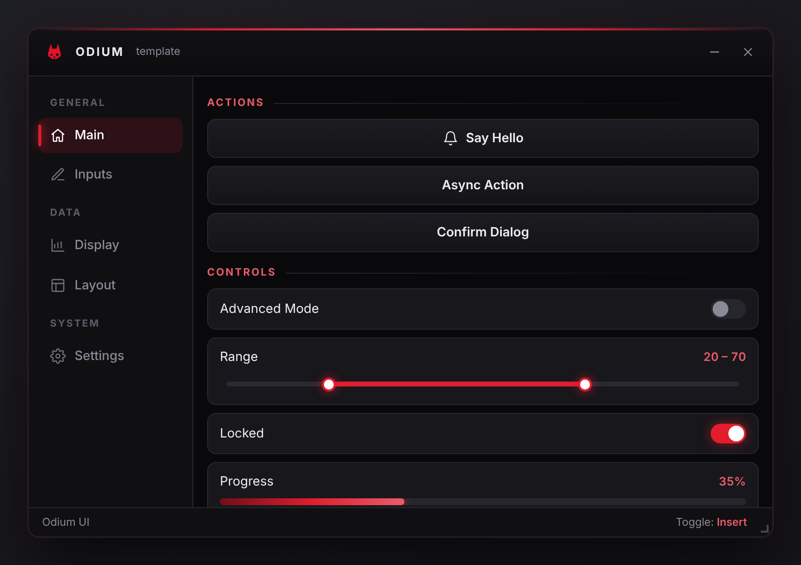
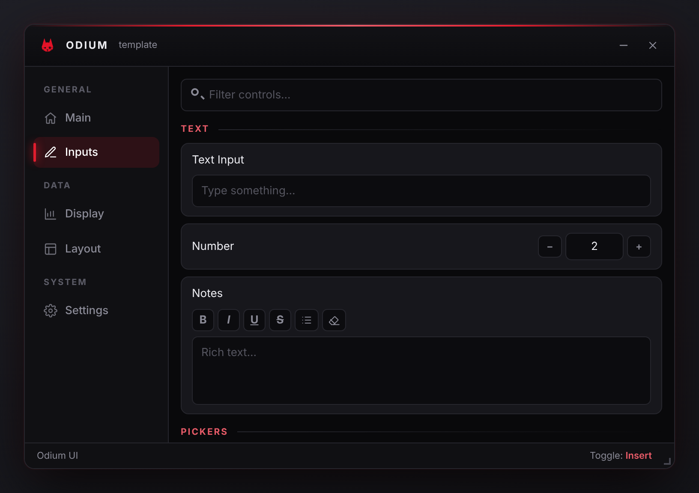
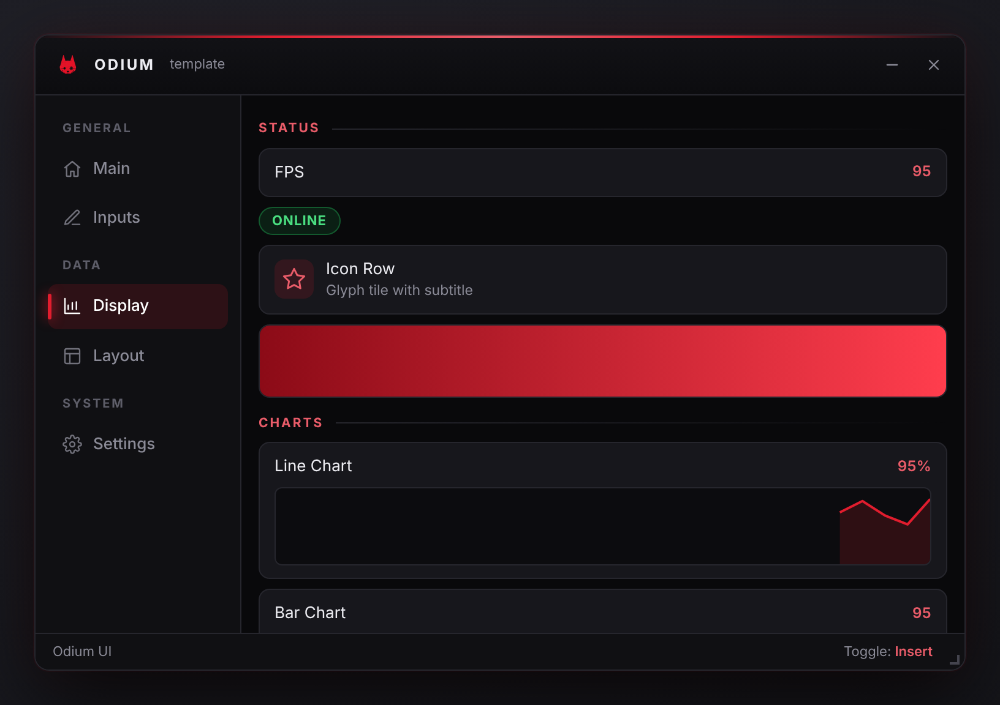
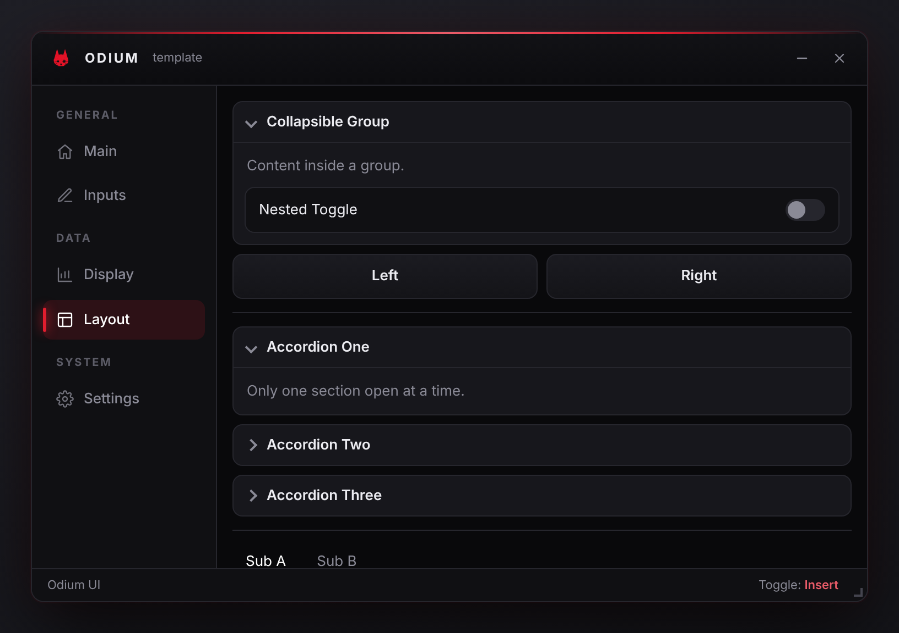
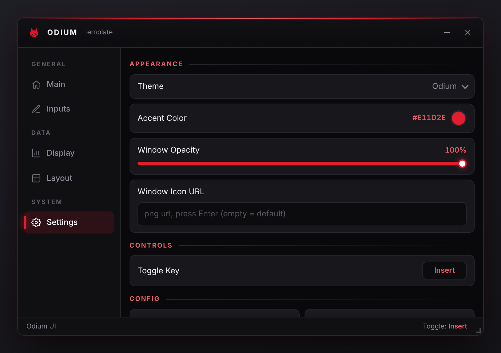
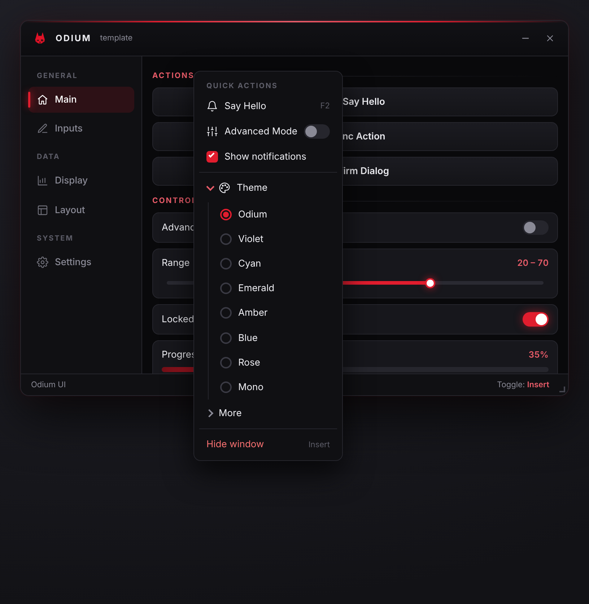

<div align="center">


# Odium UI

**A dependency-free, in-page UI toolkit for userscripts: a draggable shadow-DOM window with tabs, 30+ controls, menus, modals and saved configs.**




</div>

## Table of Contents

- [Features](#features)
- [Screenshots](#screenshots)
- [Quick Start](#quick-start)
- [Usage](#usage)
- [Components](#components)
- [Handle API](#handle-api)
- [Window API](#window-api)
- [Icons](#icons)
- [Context Menus](#context-menus)
- [Configs](#configs)
- [Theming](#theming)
- [Userscript Header](#userscript-header)
- [Project Structure](#project-structure)
- [Extending](#extending)
- [Scripts](#scripts)
- [Credits](#credits)
- [License](#license)

## Features

- **Self-contained.** No dependencies. The whole UI lives in a closed shadow root, so the page's CSS and scripts can't reach it and its own styles don't leak out.
- **Window chrome.** Drag with edge snapping, resize, minimize, opacity, a toggle hotkey and a logo.
- **30+ controls.** Buttons, toggles, sliders, range sliders, dropdowns, multi-selects, radios, checkboxes, text / number / rich-text inputs, colour pickers, keybinds, list boxes, tables, charts, logs, code blocks and more.
- **Layout.** Sidebar tabs with groups, collapsible groups, accordions, columns and sub-tabs.
- **Every control shares one API.** Tooltips, hotkeys, right-click menus, enable/disable, `showWhen` / `enableWhen` and change listeners.
- **Overlays.** Context menus with toggles, checkboxes, radios and nested accordions, plus toasts and confirm / alert / prompt modals.
- **Configs.** Every input saves, loads, exports, imports and resets automatically, alongside the theme and window settings.
- **Themes.** Eight accent presets or any hex colour; the whole palette is derived from it.
- **Line icon set.** Built in, coloured with `currentColor`, and usable anywhere an icon is accepted.
- **Two builds.** A plain library (`window.UI`) and a ready-to-install userscript template.

## Screenshots

<table>
  <tr>
    <td align="center"><br><sub><b>Inputs</b>: text, number, rich text, pickers, choices, lists</sub></td>
    <td align="center"><br><sub><b>Display</b>: stats, badges, charts, logs, tables</sub></td>
  </tr>
  <tr>
    <td align="center"><br><sub><b>Layout</b>: groups, columns, accordions, sub-tabs</sub></td>
    <td align="center"><br><sub><b>Settings</b>: built-in theme, hotkey and config tab</sub></td>
  </tr>
  <tr>
    <td align="center" colspan="2"><br><sub><b>Context menu</b>: buttons, toggles, checkboxes, radios, nested accordions</sub></td>
  </tr>
</table>

## Quick Start

```bash
npm install
npm run dev              # hot-reloading demo at http://localhost:1234
npm run build            # minified -> dist/
npm run build:readable   # unminified, easier to debug
```

| Output | What it is |
| --- | --- |
| `dist/odium-ui.user.js` | The userscript: the library **plus** your script (`src/userscript/main.js`) under a `==UserScript==` header. Install it in Tampermonkey or Violentmonkey. |
| `dist/odium-ui.js` | The library on its own. It sets `window.UI`, `window.OdiumUI` and `window.OdiumIcons`. Paste it, `@require` it, or load it with a `<script>` tag. |

> [!TIP]
> If npm isn't available, `bun scripts/build-bun.js` produces the same `dist/` files using [Bun](https://bun.sh/)'s bundler.

## Usage

Write your script in `src/userscript/main.js`:

```js
import { UI, Icons } from '../index.js';

const ui = new UI();
ui.createWindow('MY SCRIPT', { subtitle: 'v1.0', toggleKey: 'Insert' });

const main = ui.addTab('Main', { group: 'General', icon: Icons.home });

main.createSection('Actions');
main.createButton('Say hello', () => ui.notify('Hi!', 'success'), { icon: Icons.bell })
  .setHotkey('F2')
  .setTooltip('Hotkey: F2');

const adv = main.createToggle('Advanced mode', (on) => console.log(on));
main.createSlider('Speed', (v) => console.log(v), { min: 0, max: 100, value: 50, suffix: '%' })
  .showWhen(adv);

ui.addSettingsTab('Settings', { group: 'System' });
```

When you use the library build on its own, the same API is available as `new window.UI()` and `window.OdiumIcons`.

## Components

Every `create*()` method can be called on a tab, a group, a column or a sub-tab, and returns a [handle](#handle-api).

**Common options** for any input control:

| Option | Description |
| --- | --- |
| `id` | Stable config key (defaults to `TabName/Label`) |
| `save` | `false` keeps the control out of saved configs |
| `icon` | An icon shown next to the label |

### Inputs

| Method | Notable options | Value |
| --- | --- | --- |
| `createButton(text, action, o)` | `icon` | (if `action` returns a promise, a spinner shows until it settles) |
| `createToggle(text, action, initial, o)` | `value` | `boolean` |
| `createSlider(text, action, o)` | `min`, `max`, `step`, `value`, `suffix` | `number` |
| `createRangeSlider(text, action, o)` | `min`, `max`, `step`, `low`, `high`, `suffix` | `[low, high]` |
| `createNumberInput(text, action, o)` | `min`, `max`, `step`, `value` | `number` |
| `createTextInput(text, action, o)` | `placeholder`, `value`, `onEnter` | `string` |
| `createRichTextbox(text, action, o)` | `placeholder`, `value` | HTML `string` |
| `createColorPicker(text, action, o)` | `value` | hex `string` |
| `createKeybind(text, action, o)` | `value`, `onPress` | key spec, e.g. `'Ctrl+K'` |
| `createDropdown(options, action, o)` | `label`, `selected` | selected option |
| `createMultiSelect(options, action, o)` | `label`, `selected` | `string[]` |
| `createRadioGroup(text, options, action, o)` | `selected` | selected option |
| `createCheckboxGroup(text, options, action, o)` | `selected` | `string[]` |
| `createListBox(text, items, action, o)` | `multi`, `height`, `search`, `selected`, `onActivate`, `itemMenu` | value or `value[]` |
| `createSearchBox(placeholder, onSearch)` | | filters the other controls on the page |

List box items can be plain strings or `{ text, value, icon, hint }`. The handle adds `addItem`, `removeItem`, `setItems`, `setFilter`, `selectAll` and `itemCtx()` (a right-click menu for rows).

### Display

| Method | Notes |
| --- | --- |
| `createLabel(text)` / `createMultiLineLabel(text)` | `setText` |
| `createSection(text)` / `createDivider()` | headings and separators |
| `createStat(text, value, o)` | label and value row, `setValue` |
| `createBadge(text, type)` | `red`, `green`, `amber`, `blue` or `gray` (aliases `success`, `warn`, `error`, `info`) |
| `createIcon(icon, text, o)` | icon tile with `o.sub` subtitle |
| `createImage(src, o)` | `height`, `fit`, `alt` |
| `createProgressbar(text, value, o)` | `setValue(0–100)` |
| `createSpinner(text, active)` | `setActive(bool)` |
| `createChart(text, o)` | `type: 'line' \| 'bar'`, `points`, `min`, `max`, `height`, `suffix`; feed it with `push(value)` |
| `createLog(title, o)` | `log(msg, 'info' \| 'success' \| 'warn' \| 'error')`, `max`, `height` |
| `createTable(headers, rows, o)` | `addRow`, `setRows`, `onRowClick`, `height` |
| `createCodeBlock(code, o)` | copy button, `setCode`, `title` |

### Layout

| Method | Returns |
| --- | --- |
| `createGroup(title, o)` | A collapsible container (`collapsed`, `icon`) with `expand`, `collapse` and `toggle` |
| `createAccordion()` | `{ addSection(title) }`; only one section is open at a time |
| `createColumns(n)` | An array of `n` side-by-side containers |
| `createSubTabs()` | `{ addTab(name) }`, a horizontal tab strip |

## Handle API

Every control and container returns a handle. Input controls have all of these methods; display controls have the ones that make sense for them, plus extras such as `setText`.

| Method | Description |
| --- | --- |
| `getValue()` / `setValue(v, silent)` | Read or write the value (`silent` skips the callback) |
| `onChange(fn)` | Extra change listener |
| `setVisible(bool)` / `setEnabled(bool)` | Show/hide, enable/disable |
| `showWhen(src, pred)` / `enableWhen(src, pred)` | Bind visibility or enabled state to another control |
| `setTooltip(text)` | Tooltip on hover |
| `setHotkey(spec)` | Click this control on a key combo, e.g. `'Ctrl+Shift+K'` |
| `setIcon(icon)` | Icon next to the label |
| `setContextMenu(items)` / `ctx()` | Right-click menu (array or builder) |
| `destroy()` | Remove the control and its hotkey and config entry |

## Window API

| Method | Description |
| --- | --- |
| `createWindow(title, o)` | `width`, `height`, `x`, `y`, `subtitle`, `toggleKey`, `snap`, `icon` |
| `addTab(name, { group, icon })` / `selectTab(tab)` | Sidebar tabs; `group` adds a heading when it changes |
| `addSettingsTab(name, o)` | Ready-made tab for theme, accent, opacity, logo, toggle key and configs |
| `show()` / `hide()` / `toggle()` / `destroy()` | Visibility and teardown |
| `notify(text, type, ms)` | Toast: `info`, `success`, `warn`, `error` |
| `confirm(msg, o)` / `alert(msg, o)` / `prompt(msg, o)` | Promise-based modals (`prompt` accepts `{ multiline: true }`) |
| `bindKey(spec, fn)` / `unbindKey(k)` / `captureKey(cb)` | Global hotkeys |
| `setToggleKey(spec)` | Window toggle key (default `Insert`) |
| `setTheme(name)` / `setAccent(hex)` / `setOpacity(0.3–1)` | Appearance |
| `setWindowIcon(icon)` | Logo: `null` = default logo, `false` = none, or an image URL / inline `<svg>` / glyph |

## Icons

`Icons` is a set of line icons (24×24, `stroke: currentColor`), so they follow the theme and text colour:

```js
import { Icons } from '../index.js';

ui.addTab('Display', { icon: Icons.chart });
tab.createButton('Refresh', reload, { icon: Icons.refresh });
```

`home`, `grid`, `dashboard`, `sliders`, `edit`, `chart`, `layout`, `settings`, `palette`, `user`, `bell`, `star`, `check`, `x`, `plus`, `trash`, `refresh`, `copy`, `download`, `upload`, `search`, `eye`, `terminal`, `keyboard`, `monitor`, `info`, `warning`, `list`, `eraser`

Anywhere an icon is accepted, you can also pass an inline `<svg>` string, an image URL (png / svg / `data:` / `blob:`), or a short glyph.

## Context Menus

```js
const menu = ui.createContextMenu();
menu.addLabel('Quick actions');
menu.addButton('Say hello', () => ui.notify('Hi'), { icon: Icons.bell, hint: 'F2' });
menu.addToggle('Advanced', (v) => adv.setValue(v), () => adv.getValue());
menu.addCheckbox('Notifications', (v) => {}, true);
menu.addSeparator();
menu.addAccordion('Theme', { icon: Icons.palette }).addRadioGroup('', ['Odium', 'Cyan'], (v) => ui.setTheme(v));
menu.addButton('Hide window', () => ui.hide(), { danger: true });

ui.setWindowContextMenu(menu);        // right-click anywhere in the window
button.setContextMenu(menu);          // or on one control
```

## Configs

Every input control is registered under a key (its `id`, or `TabName/Label` by default).

| Method | Description |
| --- | --- |
| `saveConfig(name)` / `loadConfig(name)` | Save to / load from `localStorage` (`odium-ui:<name>`) |
| `exportConfig()` / `importConfig(json)` | JSON string with every value, plus accent, opacity, toggle key and logo |
| `resetConfig()` | Restore every control to its initial value |

The Settings tab wires all of these up to buttons.

## Theming

| Preset | Accent |
| --- | --- |
| Odium | `#E11D2E` |
| Violet | `#8B5CF6` |
| Cyan | `#06B6D4` |
| Emerald | `#10B981` |
| Amber | `#F59E0B` |
| Blue | `#3B82F6` |
| Rose | `#F43F5E` |
| Mono | `#D4D4D8` |

`setAccent(hex)` accepts any colour. Highlight and shadow shades, and a readable text colour on top of the accent, are derived from it automatically.

## Userscript Header

Edit `userscript.config.json`. `version` comes from `package.json`, and a local image path in `icon` is embedded as a `data:` URI at build time.

```json
{
  "name": "Odium UI",
  "namespace": "https://example.com/odium-ui",
  "description": "Odium UI template userscript",
  "author": "you",
  "icon": "assets/icon-48.png",
  "match": ["*://*/*"],
  "grant": ["none"],
  "run-at": "document-idle",
  "noframes": true
}
```

> [!NOTE]
> Keep `"grant": ["none"]` if you want `window.UI` to be visible to the page. Any other `@grant` runs the script in the userscript manager's sandbox, which has a separate `window`.

## Project Structure

```
odium-ui/
├── assets/                  icon.png (source logo), icon-48.png (userscript icon)
├── dev/index.html           page served by `npm run dev`
├── docs/images/             README screenshots and logo
├── scripts/
│   ├── build-bun.js         dependency-free build with Bun
│   ├── clean.js
│   ├── finalize.js          adds the userscript header, writes dist/
│   ├── make-icons.py        regenerates icon sizes from assets/icon.png
│   └── screenshots.js       regenerates docs/images
├── src/
│   ├── index.js             library entry (exports UI and Icons, sets window.UI)
│   ├── icons.js             built-in line icons
│   ├── constants.js         themes, badge types, storage prefix
│   ├── assets/logo.js       default window logo (generated)
│   ├── core/
│   │   ├── UI.js            the UI class (assembles ./ui/*.js)
│   │   ├── Container.js     anything that holds controls
│   │   ├── Handle.js        per-control API
│   │   ├── Tab.js           sidebar tab and page
│   │   ├── MenuBuilder.js   fluent context-menu builder
│   │   ├── install.js       mixes components into Container
│   │   └── ui/              one file per concern: window, drag, resize, tabs, hotkeys, theme, menus, modals, config, …
│   ├── components/          one file per control
│   ├── styles/              one CSS file per area, inlined into the shadow root
│   ├── utils/               dom, color, keys, clipboard, icons, popups
│   └── userscript/          your script: main.js, tabs/, windowMenu.js
└── userscript.config.json   userscript metadata
```

## Extending

Add a component by creating `src/components/myThing.js`:

```js
import { el } from '../utils/dom.js';

export function createMyThing(text, action, o = {}) {
  const n = el('div', 'card');
  n.textContent = text;
  const c = this._ctl(n);          // `this` is the container
  c.getValue = () => 42;
  return this._reg(c, text, o);    // makes it save/load/reset-able
}
```

Then export it from `src/components/index.js`, and add any styles as `src/styles/myThing.css`, imported from `src/styles/index.css`. It becomes available everywhere: `tab.createMyThing(...)`, `group.createMyThing(...)`, and so on.

## Scripts

| Command | Description |
| --- | --- |
| `npm run dev` | Hot-reloading demo page |
| `npm run build` | Minified library and userscript in `dist/` |
| `npm run build:readable` | Unminified build |
| `npm run build:bun` | The same build using Bun |
| `npm run icons` | Regenerate every icon size from `assets/icon.png` (needs Python and Pillow) |
| `npm run screenshots` | Rebuild and regenerate `docs/images` (needs Bun and Playwright's Chromium) |
| `npm run clean` | Remove `dist/` and the Parcel cache |

## Credits

**Odium UI** by **Nyxi**. The logo is the MeowEngine icon.

## License

MIT License with attribution requirements. See [LICENSE.md](LICENSE.md).
# odium-ui

